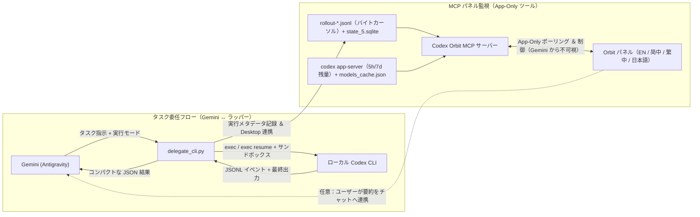

<div align="center">
  
  <h1>Codex Orbit</h1>
  <p>
    <strong>Google Antigravity 2.0 向け デュアルエージェント協調 ＆ ゼロトークン Codex ライブモニター</strong>
  </p>
  <p>
    <a href="./README.md">English</a> · <a href="./README.zh-CN.md">简体中文</a> · <a href="./README.zh-TW.md">繁體中文</a> · <strong>日本語</strong>
  </p>
  <p>
    <a href="#codex-orbit-が選ばれる理由"></a> <a href="#クイックスタート"></a> <a href="#主な機能"></a> <a href="./LICENSE"></a>
  </p>
</div>


*52 週間 AGY 依頼・直接実行ヒートマップ、モデル利用内訳、低残量ガードレール＆7 項目環境診断、ライブセッション監視、ライト／ダーク多言語 UI をホストトークン消費ゼロで一望できます。*

---

## Codex Orbit が選ばれる理由

Codex Orbit を使うと、**Antigravity 上の Gemini** からローカルの **OpenAI Codex CLI** へコーディング・テスト・調査・レビューを簡単に委任できます。進捗は Orbit パネル上でリアルタイムに追え、チャットには簡潔な結果だけが返るため、必要なときは同じ Codex セッションをそのまま再開できます。



### 他のツールとの位置づけの違い

ツールごとに担うレイヤーが異なります。API ゲートウェイはモデルリクエストのルーティング、エージェント委任ブリッジは別アシスタントの呼び出しを担い、**Codex Orbit** は **Antigravity 内蔵のライブ監視、残量連動の事前ルーティング、ローカル Codex 履歴の一元可視化** に特化しています。

| 比較項目 | モデル API ゲートウェイ<br/>*(OpenRouter / LiteLLM / CCR / CLIProxyAPI)* | エージェント委任ツール<br/>*(PAL MCP / `codex-mcp` / `codex-plugin-cc`)* | **Codex Orbit (`agy-codex-orbit`)** |
| :--- | :--- | :--- | :--- |
| **処理単位** | **HTTP モデルリクエスト単位**でルーティング（プロバイダ切替・形式変換・フォールバック。各クライアントのツールループは維持可能） | ホストから**別エージェント／CLI タスク**を呼び出し（多くがセッション ID 継続やバックグラウンド実行に対応） | **Antigravity 向け Codex タスク管理**：`codex exec` / `resume`、サンドボックス指定、`--search` を統合 |
| **進捗確認とコンテキスト** | ゲートウェイ側にログや利用画面あり。モデル側コンテキスト消費はクライアント依存 | 主にホスト会話内のツール返却やステータス確認で結果を取得 | **会話外の専用パネルで監視**：監視・制御ツールは `visibility: ["app"]`（進捗確認でモデルトークンを消費せず）、チャットへは短い JSON のみ返却 |
| **認証とクォータ確認** | API キー、クレジット、OAuth／サブスク上流連携に対応 | ローカル CLI の認証や設定済み API キーを再利用する構成が一般的 | **ローカル Codex ログインをそのまま利用**し、取得可能な 5h/7d 残量ウィンドウをヘッダーに表示 |
| **残量連動ルーティング** | レート制限時のリトライ、キーローテーション、フォールバックが中心 | 明示指定や役割ベースでのモデル選択が中心 | **エコ / バランス / 最高**：`最高` は 5h 残量がしきい値未満なら起動前に標準モデルへ自動切替（推論強度は維持）、`バランス` は複雑タスク昇格前に確認を提示 |
| **履歴と Desktop 連携** | ゲートウェイ単位のリクエストログ・集計 | 各ブリッジ／プラグイン単位のセッション再開 | **52 週間統合プロフィール**（AGY 依頼＋直接実行をローカルログ／SQLite から集計）と、対応 Codex Desktop 環境での `agy:` スレッド整理 |
| **ワークスペースと制御** | 呼び出し元クライアント側で管理 | 読取専用レビュー、バックグラウンド停止、worktree 連携に対応するものも多い | **同一フォルダ**・**読取専用**・**独立 Git worktree** に対応し、管理プロセスの停止や待機中 worktree の削除をパネルから実行可能 |

---

## 主な機能

### 1. 会話外ライブ監視 ＆ 52 週間プロフィール概要
- **2 か所への統合表示**：Antigravity の左サイドバー（`global`）と右補助ペイン（`aux_pane`）の両方に表示され、Gemini が `open_codex_orbit(focus_running=True)` を呼ぶと実行中タスクを自動フォーカスします。監視・制御ツールは `visibility: ["app"]` のため、進捗確認でホストモデルのトークンを消費しません。
- **プロフィール統計 ＆ ヒートマップ**：累計トークン、AGY 依頼比率、最長実行時間、連続稼働日数、**52 週間ヒートマップ**（`すべて / AGY 依頼 / 直接実行` と `トークン / セッション数` の切替、日付クリック絞り込み）、**モデル利用内訳**、よく変更されるファイルを集計します。
- **読みやすいキャンバス**：プロンプトや思考メモの折りたたみ、GFM Markdown 表示、最新 1 行に集約されるコマンドログ、クリックで Antigravity 側にファイルを開く変更チップを備えています。
- **多言語 UI**：`自動`（ホスト言語に追従）、`EN`、`简体中文`、`繁體中文`、`日本語` に対応。

### 2. クォータ連動 3 段階ルーティング ＆ 低残量ガードレール
ヘッダーのドロップダウンまたはチャットからいつでも切り替え可能です。**標準モデル**（初期値 `gpt-6.2-sol`）と**上位モデル**（初期値 `gpt-6.2-astra`）は、**⚙ 設定** からローカルの `~/.codex/models_cache.json` に基づいて自由に変更できます。

| タスク難易度 | エコ (`silent_low_cost`) | バランス (`ask`・初期値) | 最高 (`silent_best`) |
| :--- | :--- | :--- | :--- |
| **軽量 (`light`)** | 標準モデル (`low`/`medium`) | 標準モデル (`medium`) | 標準モデル (`medium`) |
| **標準 (`standard`)** | 標準モデル (`medium`) | 標準モデル (レビュー `medium` / 実装 `high`) | 上位モデル (`high`) * |
| **複雑 (`complex`)** | 標準モデル (`high`) | **5h/7d 残量を表示してユーザー確認** | 上位モデル (`xhigh`) * |

*\* **低残量ガードレール**（初期値: 5h 残量 `< 15%` で有効、`5%–50%` で調整可能）：`最高` では推論強度を維持したまま標準モデルへ自動切替、`バランス` では昇格確認時に注意を表示し、ヘッダーのクォータバッジが警告色に変化します。*

### 3. ワークスペースモード、Web 検索 ＆ ライブ制御
- **同一フォルダ連携 (`workspace-write`・初期値)**：運用ルールに沿って Gemini と Codex が順番に編集する場合、マージ不要で現在のワークスペースに直接反映します。
- **読取専用レビュー (`read-only`)**：ワークスペースのファイルを変更せずに独立したコードレビューや調査を実行します。
- **並列隔離 (`worktree`)**：`${PLUGIN_DATA}/worktrees` に独立した Git worktree を作成し、複数ターンで再利用します。待機中の worktree は **⚙ 設定 → 待機中 Worktree を削除** または `--prune-worktrees` で安全に整理できます。
- **ライブ Web リサーチ (`--web-search`)**：Git 管理外のフォルダでも `codex --search` による最新調査を行い、出典付き Markdown レポートを保存できます。
- **タスク停止 ＆ 要約連携**：Orbit 管理下の実行中プロセスツリーを停止し、必要なセッション／ラウンド要約だけをチャットへ添付・送信できます。

### 4. Codex Desktop 連携
依頼されたセッションには `thread/name/set` により `agy: ` プレフィックスの付与を試み、対応するプロジェクト・セクションへ紐付けた上で終了後に可視性を引き上げるため、対応した Codex Desktop 環境でそのまま続きを確認できます*（Codex Desktop が起動中の場合、新規プロジェクトの表示には再起動が必要になることがあります）*。

---

## クイックスタート

### 前提条件
1. **Google Antigravity 2.0**
2. **OpenAI Codex CLI**（または Codex Desktop / VS Code Codex 拡張）がインストール・サインイン済みであること
3. **Python 3.11 以上** *（一般ユーザー向けのインストールに Node.js や `pnpm` は不要です。ビルド済み UI `dist/index.html` を同梱しています）*

### インストール

**Windows (PowerShell):**
```powershell
git clone https://github.com/LIU423/agy-codex-orbit.git
cd agy-codex-orbit
.\scripts\install.ps1
```
> `python` に PATH が通っていない場合は `-PythonBin C:\Path\To\python.exe` を指定してください。

**macOS / Linux (`sh` / `bash` / `zsh`):**
```bash
git clone https://github.com/LIU423/agy-codex-orbit.git
cd agy-codex-orbit
./scripts/install.sh
```
> 別の Python を使う場合は `PYTHON_BIN=/path/to/python3 ./scripts/install.sh` を実行してください。

インストーラーは `~/.gemini/config/plugins/agy-codex-orbit/` へプラグインを配置し、専用 `.venv` の作成・`mcp_config.json` の生成・`--doctor` 環境診断まで自動で行います。表示されない場合はプラグインを再読み込みするか Antigravity を再起動してください。

### 環境診断の確認
- **UI から**: ヘッダー右上の **⚙** → **診断を実行**
- **CLI から**:
  ```powershell
  # Windows
  ~/.gemini/config/plugins/agy-codex-orbit/.venv/Scripts/python.exe -u ~/.gemini/config/plugins/agy-codex-orbit/server/delegate_cli.py --doctor
  ```
  ```bash
  # macOS / Linux
  ~/.gemini/config/plugins/agy-codex-orbit/.venv/bin/python -u ~/.gemini/config/plugins/agy-codex-orbit/server/delegate_cli.py --doctor
  ```

---

## 活用例

Antigravity のチャットから自然な言葉で指示できます：

- **ライブ監視を開く**：*「Codex Orbit を開いて、最近の Codex セッションとクォータ残量を確認したい。」*
- **バックエンド・フロントエンド分業**：*「このワークスペースで `/api/webhooks` の署名検証と pytest を Codex に実装させ、完了後にフロントエンドのフォームを接続して。」*
- **読取専用レビュー**：*「未コミットの変更を Codex に read-only モードでレビューさせ、競合状態や例外処理の漏れを確認して。」*
- **並列 Worktree 作業**：*「パーサーのリファクタリングは分離した git worktree で Codex に任せ、こちらでは UI を進めよう。」*
- **Web 調査レポート**：*「Codex の Web 検索を使って最新の MCP Apps 仕様変更を調査し、`research/mcp-apps.md` に出典付きでまとめて。」*
- **ルーティング切替**：*「エコモードに切り替えて」* / *「バランスモードにして」* / *「最高モードにして」*。

---

## 設定とトラブルシューティング

### 設定項目 ＆ CLI フラグ
設定は `${PLUGIN_DATA}/settings.json` に永続化され、**⚙ 設定** ポップオーバーまたは `delegate_cli.py` から変更できます。

| 設定 / CLI フラグ | 初期値 | 内容 |
| :--- | :--- | :--- |
| `--set-routing-mode` | `ask` | `silent_low_cost`（エコ）、`ask`（バランス）、`silent_best`（最高） |
| `--set-default-model` | `gpt-6.2-sol` | 標準モデルのスラッグ（空文字 `""` で初期値へリセット） |
| `--set-escalation-model` | `gpt-6.2-astra` | 複雑タスク／最高モード用の上位モデル（`""` でリセット） |
| `--set-quota-guardrail` | `on` | `on` / `off`（5h 低残量ガードレールの有効化／無効化） |
| `--set-quota-threshold` | `15` | ガードレール発動の 5h 残量しきい値（`5`–`50`%） |
| `--get-settings` / `--doctor` / `--prune-worktrees` | — | 設定取得、7 項目環境診断、待機中 worktree の一括削除 |

### 環境変数
- `CODEX_ORBIT_CODEX_BIN`：`codex` 実行ファイルの明示パス
- `CODEX_HOME`：Codex 設定ディレクトリの上書き（既定 `~/.codex`）
- `CODEX_ORBIT_DATA_DIR`：プラグインデータディレクトリの上書き

### よくある質問
- **`codex_cli` がエラーになる**：Codex CLI がインストール・ログイン済みか確認するか、`CODEX_ORBIT_CODEX_BIN` を指定してください。
- **クォータが rollout キャッシュ表示になる**：オフラインや未認証時は、`codex app-server` の代わりに最新のローカル rollout 内の `rate_limits` を参照します。
- **開発用リンクでの利用**：`.\scripts\dev-link.ps1`（Windows）または `./scripts/dev-link.sh`（macOS/Linux）を使用してください。詳細は [開発ガイド](./docs/DEVELOPMENT.md) を参照してください。

---

## 開発とテスト

UI ビルド（`ui/`）、開発用リンク（`dev-link.ps1` / `dev-link.sh`）、MCP 再読込（`refresh-mcp.ps1`）、および 72 件の自動テスト（`pytest -v`）の詳細は [docs/DEVELOPMENT.md](./docs/DEVELOPMENT.md) をご覧ください。

## ライセンス

[MIT License](./LICENSE) のもとで公開されています。
