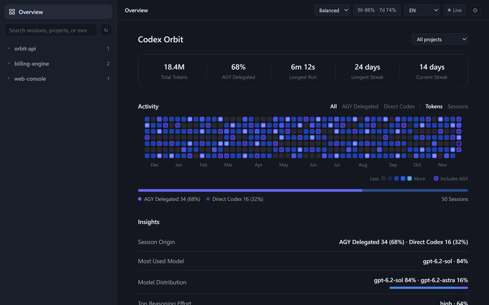
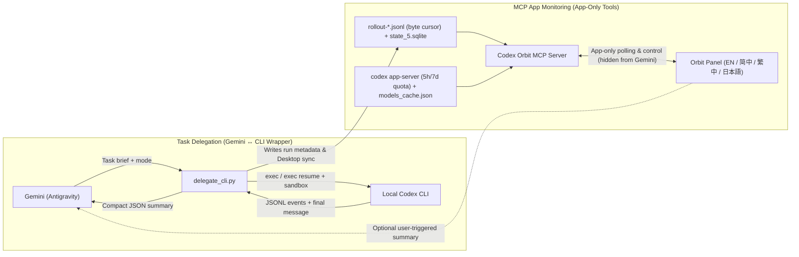
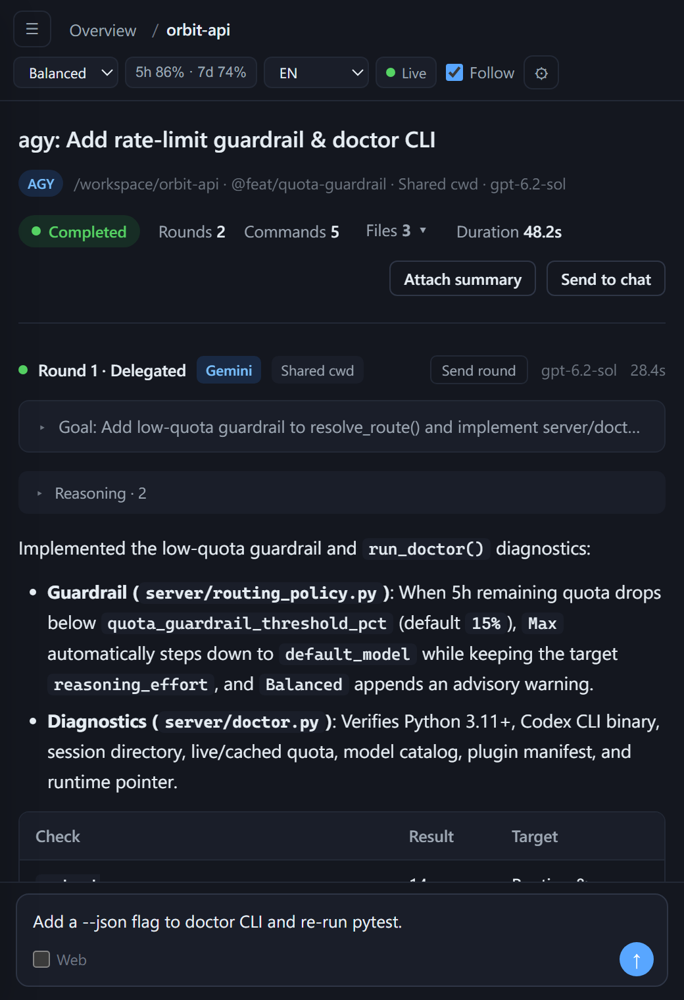

<div align="center">
  
  <h1>Codex Orbit</h1>
  <p>
    <strong>Antigravity → Codex delegation harness &amp; zero-token local observability cockpit</strong>
  </p>
  <p>
    <strong>English</strong> · <a href="./README.zh-CN.md">简体中文</a> · <a href="./README.zh-TW.md">繁體中文</a> · <a href="./README.ja.md">日本語</a>
  </p>
  <p>
    <a href="#why-codex-orbit"></a> <a href="#quick-start"></a> <a href="#core-features"></a> <a href="./LICENSE"></a> <a href="https://github.com/LIU423/agy-codex-orbit/actions/workflows/ci.yml"></a>
  </p>
</div>

**Codex Orbit** is a Google Antigravity 2.0 MCP App plugin that lets Gemini delegate coding, testing, debugging, and review tasks to your local **OpenAI Codex CLI**—with skill-based model routing, Git worktree isolation, and a live local dashboard that watches progress at zero host-model token cost.



*52-week AGY vs. Direct Codex heatmap, model distribution, 5h/7d quota guardrail, 7-point diagnostics, live session streaming, and Light/Dark multi-language UI.*

---

## Why Codex Orbit?

Delegating work from one coding agent to another usually means either burning host tokens to poll status or losing visibility into what the worker is doing. Codex Orbit separates **execution** from **observation**: Gemini dispatches scoped runs through `delegate_cli.py`, you watch live progress and send direct follow-ups in the Orbit pane (`visibility: ["app"]`), and Gemini only receives a compact JSON summary when the turn finishes.



### How It Compares

| Dimension | Model API Gateways<br/>*(OpenRouter / LiteLLM / CCR / CLIProxyAPI)* | Agent Delegation Bridges<br/>*(PAL MCP / `codex-mcp` / `codex-plugin-cc`)* | **Codex Orbit (`agy-codex-orbit`)** |
| :--- | :--- | :--- | :--- |
| **Unit of Work** | Routes **HTTP model requests** (provider selection, format translation, fallbacks) | Delegates **agent tasks** from a host tool/CLI | **Antigravity-to-Codex cockpit**: wraps `codex exec` / `resume` with workspace modes, sandbox flags, and `--search` |
| **Live Progress & Context** | Logs live in the proxy; model context depends on the client | Returns structured tool outputs or background polls in host chat | **Out-of-band Orbit panel**: polling and follow-ups use `visibility: ["app"]` (0 host tokens); Gemini gets a short JSON result |
| **Auth & Quota** | API keys, credits, and OAuth/subscription upstreams | Reuses local CLI logins or configured API keys | **Reuses local Codex sign-in** and surfaces live 5h/7d rate-limit windows in the topbar |
| **Quota-Aware Routing** | Rate-limit retries, key rotation, and fallback models | Explicit model selection or static role mapping | **Eco / Balanced / Max**: `Max` steps down to your default model when 5h quota `< threshold` (keeping reasoning effort); `Balanced` confirms complex escalations |
| **History & Desktop Sync** | Per-gateway request logs | Session resume per bridge or host plugin | **Unified 52-week Profile** (AGY delegated + Direct Codex from local JSONL/SQLite) + `agy:` titles and project binding in Codex Desktop |
| **Workspace & Control** | Managed by the calling client | Read-only review, background cancel, or worktree wrappers | **Shared cwd**, **read-only**, or **Git worktree** per session, process-tree stop button, and idle-worktree pruning |

---

## Core Features

### 1. Out-of-Band Live Monitor & 52-Week Profile
- **Dual Mounting & Direct Follow-up**: Runs in Antigravity's left sidebar (`global`) and right auxiliary pane (`aux_pane`), auto-focusing active runs when Gemini calls `open_codex_orbit(focus_running=True)`. In the narrow side pane, the session tree collapses into a drawer and a **direct Codex follow-up composer** (`orbit_send_followup`) stays docked at the bottom. Polling and follow-ups use `visibility: ["app"]`, costing zero host model tokens.
- **Profile Overview & Heatmap**: Tracks total tokens, AGY vs. Direct Codex share, longest run, active streaks, a **52-week calendar heatmap** (filterable by `All / AGY Delegated / Direct Codex` and `Tokens / Sessions`, with click-to-filter day drill-down), **Model Distribution**, and frequently modified files.
- **Clean Reading Canvas**: Collapsible turn prompts, reasoning summaries, GFM Markdown rendering, muted single-row collapsed command logs, and clickable changed-file chips that open in Antigravity.
- **Multilingual UI**: `Auto` (follows host locale), `EN`, `简体中文`, `繁體中文`, and `日本語`.

<p align="center">
  
</p>

### 2. Quota-Aware 3-Mode Routing & Low-Quota Guardrail
Switch policies from the topbar dropdown or via chat. Both **default** (`gpt-6.2-sol`) and **escalation** (`gpt-6.2-astra`) models are configurable from `~/.codex/models_cache.json` inside **⚙ Settings**.

| Task Tier | `Eco` (`silent_low_cost`) | `Balanced` (`ask`, default) | `Max` (`silent_best`) |
| :--- | :--- | :--- | :--- |
| **Light** | Default model (`low`/`medium`) | Default model (`medium`) | Default model (`medium`) |
| **Standard** | Default model (`medium`) | Default model (`medium` review / `high` code) | Escalation model (`high`) * |
| **Complex** | Default model (`high`) | **Asks user + live 5h/7d quota readout** | Escalation model (`xhigh`) * |

*\* **Low-Quota Guardrail** (default `< 15%` 5h remaining, configurable `5%–50%`): in `Max`, automatically steps down to your default model while keeping the target reasoning effort; in `Balanced`, attaches a warning before escalating; topbar quota badge turns amber/red.*

### 3. Workspace Modes, Web Research & Live Control
- **Same-Workspace Handoff (`workspace-write`, default)**: Codex edits directly in your active Antigravity workspace for serial handoffs—no merge step needed.
- **Read-Only Review (`read-only`)**: Independent audits and diff reviews without touching workspace files.
- **Parallel Isolation (`worktree`)**: Spawns an isolated Git worktree per session under `${PLUGIN_DATA}/worktrees`, reuses it across `resume` turns, and cleans idle worktrees via **⚙ Settings → Prune idle worktrees** or `--prune-worktrees`.
- **Live Web Research (`--web-search`)**: Uses Codex's native `--search` tool in Git or non-Git folders and writes cited Markdown reports to your workspace.
- **Process Control & Selective Handoff**: Cleanly terminates the child process tree of any Orbit-managed run and lets you send only concise round/session summaries back to Gemini.

### 4. Codex Desktop Continuity
Delegated runs title threads with an `agy: ` prefix via `codex app-server` (`thread/name/set`), bind them to the matching workspace project/section, and promote closed `exec` rollout visibility so compatible Codex Desktop setups can display and continue them *(if Codex Desktop is already open, restart it to show newly created projects)*.

---

## Quick Start

### Prerequisites
1. **Google Antigravity 2.0**
2. **OpenAI Codex CLI** (or Codex Desktop / VS Code Codex extension), installed and signed in
3. **Python 3.11+** *(No Node.js or `pnpm` required—`dist/index.html` is pre-built)*

### Install

**Windows (PowerShell):**
```powershell
git clone https://github.com/LIU423/agy-codex-orbit.git
cd agy-codex-orbit
.\scripts\install.ps1
```
> Pass `-PythonBin C:\Path\To\python.exe` if `python` is not on `PATH`.

**macOS / Linux (`sh` / `bash` / `zsh`):**
```bash
git clone https://github.com/LIU423/agy-codex-orbit.git
cd agy-codex-orbit
./scripts/install.sh
```
> Override the interpreter with `PYTHON_BIN=/path/to/python3 ./scripts/install.sh`.

Both installers copy the plugin to `~/.gemini/config/plugins/agy-codex-orbit/`, create an isolated `.venv`, write `mcp_config.json`, and run `--doctor` diagnostics automatically. Reload plugins or restart Antigravity if **Codex Orbit** does not appear immediately.

### Verify Setup (`--doctor`)
- **In UI**: Click **⚙** in the Codex Orbit topbar → **Run check**.
- **In Terminal**:
  ```powershell
  # Windows
  ~/.gemini/config/plugins/agy-codex-orbit/.venv/Scripts/python.exe -u ~/.gemini/config/plugins/agy-codex-orbit/server/delegate_cli.py --doctor
  ```
  ```bash
  # macOS / Linux
  ~/.gemini/config/plugins/agy-codex-orbit/.venv/bin/python -u ~/.gemini/config/plugins/agy-codex-orbit/server/delegate_cli.py --doctor
  ```

---

## Usage Examples

Ask Gemini naturally inside Antigravity:

- **Open Monitor**: *"Open Codex Orbit to check my recent Codex sessions and remaining quota."*
- **Backend + Frontend**: *"Let Codex implement the `/api/webhooks` signature validator and pytest suite in this workspace, then wire up the settings form in the frontend."*
- **Read-Only Review**: *"Have Codex review my uncommitted changes in read-only mode for race conditions and missing error handling."*
- **Parallel Worktree**: *"Delegate the parser refactor to Codex in an isolated git worktree while we keep working on the UI here."*
- **Live Web Research**: *"Use Codex with web search to research the latest MCP Apps spec updates and write a cited summary to `research/mcp-apps.md`."*
- **Switch Routing Mode**: *"Switch Codex Orbit to Eco mode"* / *"Balanced mode"* / *"Max mode"*.

---

## Configuration & Troubleshooting

### Settings & CLI Flags
Preferences persist in `${PLUGIN_DATA}/settings.json` and can be updated in **⚙ Settings** or via `delegate_cli.py`:

| Setting / CLI Flag | Default | Description |
| :--- | :--- | :--- |
| `--set-routing-mode` | `ask` | `silent_low_cost` (Eco), `ask` (Balanced), `silent_best` (Max) |
| `--set-default-model` | `gpt-6.2-sol` | Default model slug (pass `""` to reset) |
| `--set-escalation-model` | `gpt-6.2-astra` | Escalation model slug for complex/Max tasks (pass `""` to reset) |
| `--set-quota-guardrail` | `on` | `on` / `off` for 5h low-quota protection |
| `--set-quota-threshold` | `15` | 5h remaining quota threshold percentage (`5`–`50`) |
| `--get-settings` / `--doctor` / `--prune-worktrees` | — | Print persisted settings, run 7-point diagnostics, or clean idle worktrees |

### Environment Variables
- `CODEX_ORBIT_CODEX_BIN`: Explicit path to `codex` / `codex.exe` if not on `PATH`.
- `CODEX_HOME`: Override Codex home directory (defaults to `~/.codex`).
- `CODEX_ORBIT_DATA_DIR`: Override plugin data directory.

### Common Issues
- **`codex_cli` check fails**: Sign in to Codex CLI (`codex`) or set `CODEX_ORBIT_CODEX_BIN`.
- **Quota shows rollout fallback**: Live quota uses `codex app-server`; when offline or unauthenticated, Codex Orbit falls back to the latest local rollout's `rate_limits`.
- **Developing from a local checkout**: Run `.\scripts\dev-link.ps1` (Windows) or `./scripts/dev-link.sh` (macOS/Linux); see [docs/DEVELOPMENT.md](./docs/DEVELOPMENT.md).

---

## Development & Testing

For UI builds (`ui/`), live dev-linking (`dev-link.ps1` / `dev-link.sh`), and running the synthetic test suite (`pytest -v`), see [docs/DEVELOPMENT.md](./docs/DEVELOPMENT.md).

To hot-reload the MCP server from an Antigravity terminal:
- **Windows**: `.\scripts\refresh-mcp.ps1`
- **macOS / Linux**: `./scripts/refresh-mcp.sh`

## Roadmap

- Publish to PyPI for one-command setup with `uvx` or `pipx`.
- Review Git worktree diffs in the dashboard and merge, discard, or clean up with one click.
- Add per-task timeouts, step and budget limits, and live controls to stop or steer delegated tasks.
- Support pluggable adapters beyond Antigravity and Codex, including Claude Code and generic MCP clients.

## License

Distributed under the [MIT License](./LICENSE).
