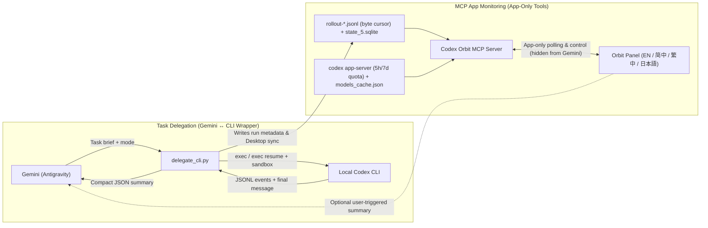

<div align="center">
  
  <h1>Codex Orbit</h1>
  <p>
    <strong>Native Dual-Agent Orchestration & Zero-Token Codex Cockpit for Google Antigravity 2.0</strong>
  </p>
  <p>
    <strong>English</strong> · <a href="./README.zh-CN.md">简体中文</a> · <a href="./README.zh-TW.md">繁體中文</a> · <a href="./README.ja.md">日本語</a>
  </p>
  <p>
    <a href="#why-codex-orbit"></a> <a href="#quick-start"></a> <a href="#core-features"></a> <a href="./LICENSE"></a>
  </p>
</div>


*52-week AGY vs. Direct Codex heatmap, model distribution, low-quota guardrail & 7-point diagnostics, live session monitoring, and Light/Dark multi-language UI — at zero host model token cost.*

---

## Why Codex Orbit?

Codex Orbit lets **Gemini in Antigravity** hand coding, testing, debugging, and review tasks to your local **OpenAI Codex CLI**. You watch live progress in the Orbit panel without polling the chat, receive a compact result back in Gemini, and resume the same Codex session whenever you need another round.



### How It Compares to Other Tools

Different tools solve different layers of the workflow. API gateways route model requests; CLI/MCP bridges let one assistant call another; **Codex Orbit** focuses on Antigravity-native live monitoring, quota-gated delegation, and unified local Codex history:

| Dimension | Model API Gateways<br/>*(OpenRouter / LiteLLM / CCR / CLIProxyAPI)* | Agent Delegation Bridges<br/>*(PAL MCP / `codex-mcp` / `codex-plugin-cc`)* | **Codex Orbit (`agy-codex-orbit`)** |
| :--- | :--- | :--- | :--- |
| **Unit of Work** | Routes **HTTP model requests** (provider selection, format translation, fallbacks; clients still keep their own tool loops) | Delegates **agent tasks** from a host tool/CLI (many support session IDs, sub-CLIs, or background runs) | **Antigravity-to-Codex task cockpit**: wraps `codex exec` / `resume` with workspace modes, sandbox flags, and optional `--search` |
| **Live Progress & Context** | Dashboard/logs live in the proxy; model context depends on the client | Typically returns structured tool outputs or background status polls in the host session | **Out-of-band Orbit panel**: panel polling & controls use `visibility: ["app"]` (no model tokens to watch progress); Gemini gets a short JSON result |
| **Auth & Quota** | Supports API keys, credits, and OAuth/subscription upstream setups | Often reuses local CLI logins or configured API keys | **Reuses local Codex sign-in** and surfaces available 5h/7d rate-limit windows directly in the Orbit topbar |
| **Quota-Aware Routing** | Focuses on rate-limit retries, key rotation, and fallback models | Usually picks models explicitly or by role | **Eco / Balanced / Max**: `Max` steps down to your default model before launch when 5h quota `< threshold` (keeping reasoning effort); `Balanced` flags complex tasks for confirmation |
| **History & Desktop Sync** | Per-gateway request logs/analytics | Session resume per bridge or host plugin | **Unified 52-week Profile** (AGY delegated + Direct Codex from local logs/SQLite) plus `agy:` titles & workspace project binding in compatible Codex Desktop setups |
| **Workspace & Control** | Managed by whichever client calls the gateway | Many offer read-only review, background cancel, or worktree wrappers | **Shared cwd**, **read-only**, or **Git worktree** per session, process-tree stop button, and safe idle-worktree pruning |

---

## Core Features

### 1. Out-of-Band Live Monitor & 52-Week Profile
- **Dual Mounting**: Lives in both Antigravity's left sidebar (`global`) and right auxiliary pane (`aux_pane`), auto-focusing newly dispatched tasks when Gemini invokes `open_codex_orbit(focus_running=True)`. Panel polling and controls use `visibility: ["app"]` so watching progress costs zero host model tokens.
- **Profile Overview & Heatmap**: Tracks total tokens, AGY vs. Direct Codex share, longest run, active streaks, a **52-week calendar heatmap** (filterable by `All / AGY Delegated / Direct Codex` and `Tokens / Sessions`, with click-to-filter day drill-down), **Model Distribution**, and frequently modified files.
- **Clean Reading Canvas**: Collapsible turn prompts, reasoning summaries, GFM Markdown rendering, muted single-row collapsed command logs, and clickable changed-file chips that open directly in Antigravity.
- **Multilingual UI**: `Auto` (follows host locale), `简体中文`, `繁體中文`, `EN`, and `日本語`.

### 2. Quota-Aware 3-Mode Routing & Low-Quota Guardrail
Switch policies anytime from the topbar dropdown or via chat. Both **default** (`gpt-6.2-sol`) and **escalation** (`gpt-6.2-astra`) models are configurable from your local `~/.codex/models_cache.json` catalog inside **⚙ Settings**.

| Task Tier | `Eco` (`silent_low_cost`) | `Balanced` (`ask`, default) | `Max` (`silent_best`) |
| :--- | :--- | :--- | :--- |
| **Light** | Default model (`low`/`medium`) | Default model (`medium`) | Default model (`medium`) |
| **Standard** | Default model (`medium`) | Default model (`medium` review / `high` code) | Escalation model (`high`) * |
| **Complex** | Default model (`high`) | **Asks user + live 5h/7d quota readout** | Escalation model (`xhigh`) * |

*\* **Low-Quota Guardrail** (enabled by default at `< 15%` 5h remaining, configurable `5%–50%`): in `Max`, automatically falls back to your default model while preserving the target reasoning effort; in `Balanced`, attaches an advisory warning before escalating; topbar quota badge highlights in amber/red.*

### 3. Workspace Modes, Web Research & Live Control
- **Same-Workspace Handoff (`workspace-write`, default)**: When Gemini and Codex edit sequentially by workflow convention, Codex writes directly in your active Antigravity workspace — no merge step needed.
- **Read-Only Review (`read-only`)**: Independent audits and PR/diff reviews without modifying files in the workspace.
- **Parallel Isolation (`worktree`)**: Spawns an isolated Git worktree per session under `${PLUGIN_DATA}/worktrees`, reuses it across multi-turn follow-ups, and cleans idle worktrees safely via **⚙ Settings → Prune idle worktrees** or `--prune-worktrees`.
- **Live Web Research (`--web-search`)**: Uses Codex's native `--search` tool in Git or non-Git folders and writes cited Markdown reports back to your workspace.
- **Live Process Control & Selective Handoff**: Stop any Orbit-managed running task cleanly (terminates the full child process tree) and attach or send only concise round/session summaries back to Gemini.

### 4. Codex Desktop Continuity
Delegated runs attempt to title threads with an `agy: ` prefix via `codex app-server` (`thread/name/set`), bind them to the matching workspace project/section, and promote closed `exec` rollout visibility so compatible Codex Desktop setups can display and continue them *(if Codex Desktop is already open, a restart may be needed to show newly created projects)*.

---

## Quick Start

### Prerequisites
1. **Google Antigravity 2.0**
2. **OpenAI Codex CLI** (or Codex Desktop / VS Code Codex extension) installed and signed in
3. **Python 3.11+** *(No Node.js or `pnpm` required — the single-file UI bundle is pre-built in `dist/index.html`)*

### Install

**Windows (PowerShell):**
```powershell
git clone https://github.com/LIU423/agy-codex-orbit.git
cd agy-codex-orbit
.\scripts\install.ps1
```
> If `python` is not on your `PATH`, pass `-PythonBin C:\Path\To\python.exe`.

**macOS / Linux (`sh` / `bash` / `zsh`):**
```bash
git clone https://github.com/LIU423/agy-codex-orbit.git
cd agy-codex-orbit
./scripts/install.sh
```
> If `python3` is not the target interpreter, run `PYTHON_BIN=/path/to/python3 ./scripts/install.sh`.

Both installers copy the plugin bundle to `~/.gemini/config/plugins/agy-codex-orbit/`, create an isolated `.venv` inside the plugin directory, generate `mcp_config.json`, and run `--doctor` diagnostics automatically. Reload plugins or restart Antigravity if the **Codex Orbit** entry does not appear immediately.

### Verify Health
- **In UI**: Click **⚙** in the Codex Orbit topbar → **Run check**.
- **In Terminal**:
  ```powershell
  # Windows
  ~/.gemini/config/plugins/agy-codex-orbit/.venv/Scripts/python.exe -u ~/.gemini/config/plugins/agy-codex-orbit/server/delegate_cli.py --doctor
  ```
  ```bash
  # macOS / Linux
  ~/.gemini/config/plugins/agy-codex-orbit/.venv/bin/python -u ~/.gemini/config/plugins/agy-codex-orbit/server/delegate_cli.py --doctor
  ```

---

## Usage Examples

Just ask Gemini naturally inside Antigravity:

- **Open Monitor**: *"Open Codex Orbit to check my recent Codex sessions and remaining quota."*
- **Backend + Frontend Collaboration**: *"Let Codex implement the `/api/webhooks` signature validator and pytest suite in this workspace, then wire up the settings form in the frontend."*
- **Independent Read-Only Review**: *"Have Codex review my uncommitted changes in read-only mode for race conditions and missing error handling."*
- **Parallel Feature Work**: *"Delegate the parser refactor to Codex in an isolated git worktree while we keep working on the UI here."*
- **Live Web Research**: *"Use Codex with web search to research the latest MCP Apps spec updates and write a cited summary to `research/mcp-apps.md`."*
- **Switch Routing Policy**: *"Switch Codex Orbit to Eco mode"* / *"Balanced mode"* / *"Max mode"*.

---

## Configuration & Troubleshooting

### Settings & CLI Flags
All user preferences persist in `${PLUGIN_DATA}/settings.json` and can be changed in the **⚙ Settings** popover or via `delegate_cli.py`:

| Setting / CLI Flag | Default | Description |
| :--- | :--- | :--- |
| `--set-routing-mode` | `ask` | `silent_low_cost` (Eco), `ask` (Balanced), `silent_best` (Max) |
| `--set-default-model` | `gpt-6.2-sol` | Default model slug (pass `""` to reset) |
| `--set-escalation-model` | `gpt-6.2-astra` | Escalation model slug for complex/Max tasks (pass `""` to reset) |
| `--set-quota-guardrail` | `on` | `on` / `off` for 5h low-quota protection |
| `--set-quota-threshold` | `15` | 5h remaining quota threshold percentage (`5`–`50`) |
| `--get-settings` / `--doctor` / `--prune-worktrees` | — | Print persisted settings, run 7-point diagnostics, or clean idle worktrees |

### Environment Variables
- `CODEX_ORBIT_CODEX_BIN`: Explicit path to `codex` / `codex.exe` if installed in a non-standard location.
- `CODEX_HOME`: Override Codex home directory (defaults to `~/.codex`).
- `CODEX_ORBIT_DATA_DIR`: Override plugin data directory.

### Common Issues
- **`codex_cli` check fails**: Sign in to Codex CLI (`codex`) or set `CODEX_ORBIT_CODEX_BIN` to your executable path.
- **Quota shows rollout fallback**: Live quota uses `codex app-server`; when offline or unauthenticated, Codex Orbit falls back to the latest local rollout's `rate_limits`.
- **Running in dev checkout**: Use `.\scripts\dev-link.ps1` (Windows) or `./scripts/dev-link.sh` (macOS/Linux); see [Development Guide](./docs/DEVELOPMENT.md).

---

## Development & Testing

For UI rebuilding (`ui/`), live dev-linking (`dev-link.ps1` / `dev-link.sh`), MCP hot-refresh (`refresh-mcp.ps1`), and running the 72-test synthetic suite (`pytest -v`), see [docs/DEVELOPMENT.md](./docs/DEVELOPMENT.md).

## License

Distributed under the [MIT License](./LICENSE).
