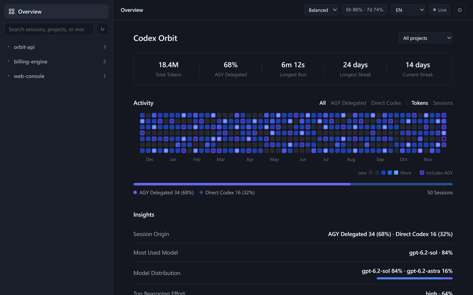
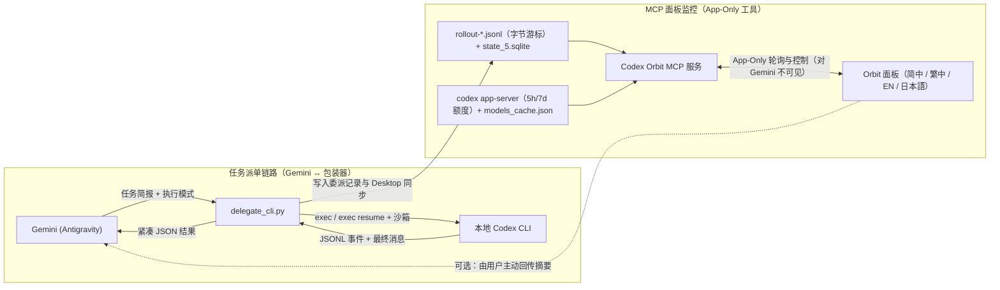
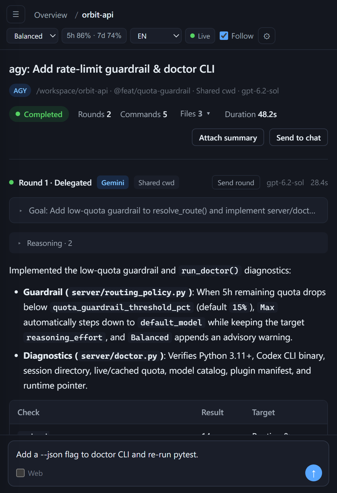

<div align="center">
  
  <h1>Codex Orbit</h1>
  <p>
    <strong>面向 Google Antigravity 2.0 的双 Agent 委派与零 Token 实时监控驾驶舱</strong>
  </p>
  <p>
    <a href="./README.md">English</a> · <strong>简体中文</strong> · <a href="./README.zh-TW.md">繁體中文</a> · <a href="./README.ja.md">日本語</a>
  </p>
  <p>
    <a href="#为什么选择-codex-orbit"></a> <a href="#快速开始"></a> <a href="#核心特性"></a> <a href="./LICENSE"></a> <a href="https://github.com/LIU423/agy-codex-orbit/actions/workflows/ci.yml"></a>
  </p>
</div>

**Codex Orbit** 是面向 Google Antigravity 2.0 的 MCP App 插件，让 Gemini 把编码、测试、排障和审查任务交给本地 **OpenAI Codex CLI**——内置 Skill 路由、Git worktree 隔离与本地实时监控面板，查看进度与追问全程不消耗宿主模型 Token。



*52 周 AGY 派单与直接运行热力图、模型分布、5h/7d 额度护栏、7 项环境自检、实时流式监控及深浅色多语言界面。*

---

## 为什么选择 Codex Orbit？

让一个编码 Agent 给另一个 Agent 派活，常见痛点要么是宿主对话不断轮询白烧 Token，要么是子 Agent 跑起来后黑盒不可见。Codex Orbit 把**执行链路**与**观测链路**彻底拆开：Gemini 通过 `delegate_cli.py` 派发带作用域的任务，你在 Orbit 面板实时看进度并可直接追加指令（`visibility: ["app"]`），回合结束时 Gemini 只收回一份紧凑的 JSON 摘要。



### 定位对比

| 对比维度 | 模型 API 网关<br/>*(OpenRouter / LiteLLM / CCR / CLIProxyAPI)* | Agent 委派工具<br/>*(PAL MCP / `codex-mcp` / `codex-plugin-cc`)* | **Codex Orbit (`agy-codex-orbit`)** |
| :--- | :--- | :--- | :--- |
| **工作单位** | 路由**单次 HTTP 模型请求**（选路、协议转换、故障回退） | 从宿主调起**另一套 Agent/CLI** | **Antigravity → Codex 驾驶舱**：封装 `codex exec` / `resume`、沙箱模式与 `--search` |
| **进度观测与上下文** | 日志留在网关侧；上下文占用取决于客户端 | 在宿主对话内通过工具返回值或状态轮询获取结果 | **独立面板外置观测**：轮询与追问声明 `visibility: ["app"]`（0 宿主 Token），主对话只收简短 JSON |
| **认证与额度** | API Key、Credits 与 OAuth/订阅上游 | 沿用本机 CLI 登录或配置的 API Key | **复用本机 Codex 登录**，顶栏实时展示 5h/7d 额度窗口 |
| **额度感知路由** | 限流重试、凭据轮询与上游模型回退 | 显式指定模型或静态角色映射 | **节能 / 均衡 / 极致**：`极致` 在 5h 额度低于阈值时派单前自动切回默认模型（保留推理强度）；`均衡` 复杂任务先确认 |
| **历史与 Desktop 联动** | 网关级请求日志 | 按各自插件或桥接会话 ID 续接 | **52 周统一 Profile**（合并 AGY 派单与直接运行的本地 JSONL/SQLite）+ Codex Desktop `agy:` 标题与项目绑定 |
| **工作区与控制** | 由调用方客户端管理 | 只读审查、后台取消或 worktree 封装 | **同目录**、**只读**、**Git worktree**，面板一键终止进程树并安全清理空闲 worktree |

---

## 核心特性

### 1. 面板外置实时监控 & 52 周 Profile 总览
- **双入口挂载与直接追问**：同时挂载在 Antigravity 左侧栏（`global`）与右侧辅助栏（`aux_pane`），Gemini 调用 `open_codex_orbit(focus_running=True)` 时自动聚焦运行中任务。窄幅右侧栏会自动将树形列表收纳为抽屉，并在底部常驻 **Codex 直接追问输入框**（`orbit_send_followup`）。面板轮询与追问均声明 `visibility: ["app"]`，不消耗宿主模型 Token。
- **Profile 总览与热力图**：展示累计 Token、AGY 派单占比、最长任务耗时、连续活跃天数、**52 周日历热力图**（支持 `全部 / AGY 派单 / 自己发起` 与 `Token / 会话数` 切换及日期下钻）、**模型用量分布**与高频改动文件。
- **清爽阅读流**：可折叠的 Prompt 与思考摘要、GFM Markdown 渲染、默认折叠成单行灰阶的命令流，以及点击即可在 Antigravity 打开的改动文件标签。
- **多语言界面**：`自动`（跟随宿主语言）、`EN`、`简体中文`、`繁體中文`、`日本語`。

<p align="center">
  
</p>

### 2. 额度感知三档调度 & 低额度保护
可在顶栏下拉框或对话中随时切换策略；**默认主力模型**（`gpt-6.2-sol`）与**复杂升级模型**（`gpt-6.2-astra`）均可在 **⚙ 设置** 中从 `~/.codex/models_cache.json` 自由选择。

| 任务难度 | 节能 (`silent_low_cost`) | 均衡 (`ask`，默认) | 极致 (`silent_best`) |
| :--- | :--- | :--- | :--- |
| **轻量 (`light`)** | 默认模型 (`low`/`medium`) | 默认模型 (`medium`) | 默认模型 (`medium`) |
| **常规 (`standard`)** | 默认模型 (`medium`) | 默认模型 (`medium` 审查 / `high` 编码) | 升级模型 (`high`) * |
| **复杂 (`complex`)** | 默认模型 (`high`) | **附实时 5h/7d 额度请用户确认** | 升级模型 (`xhigh`) * |

*\* **低额度自动保护**（默认在 5h 剩余 `< 15%` 触发，可在 `5%–50%` 调节）：`极致` 模式下自动回退默认模型并保留目标推理强度；`均衡` 模式下在升级确认中附带提醒；顶栏额度角标变为琥珀色/红色。*

### 3. 工作区模式、联网调研与实时控制
- **同目录交接 (`workspace-write`，默认)**：按分工约定前后端顺序开发时，Codex 直接在当前 Antigravity 工作区写入代码，无需额外合并。
- **只读审查 (`read-only`)**：独立审计改动或排查问题，不修改工作区文件。
- **并行隔离 (`worktree`)**：在 `${PLUGIN_DATA}/worktrees` 下按会话创建独立 Git worktree，多轮 `resume` 自动复用，结束后通过 **⚙ 设置 → 清理空闲 Worktree** 或 `--prune-worktrees` 安全清理。
- **联网调研 (`--web-search`)**：启用 Codex 原生 `--search` 工具，在 Git 或非 Git 目录完成实时调研并写出带引用的 Markdown 报告。
- **进程树控制与按需回传**：一键终止受管任务进程树，并支持将精简回合或会话摘要回传给 Gemini。

### 4. Codex Desktop 衔接
派单任务会通过 `codex app-server`（`thread/name/set`）自动添加 `agy: ` 前缀、绑定对应工作区项目与分组，并在结束后提升闭合 `exec` rollout 的可见性，便于在兼容的 Codex Desktop 中继续查看或接管*（若 Codex Desktop 已开启，新建项目可能需要重启客户端刷新）*。

---

## 快速开始

### 前置条件
1. **Google Antigravity 2.0**
2. 已安装并登录 **OpenAI Codex CLI**（或 Codex Desktop / VS Code Codex 扩展）
3. **Python 3.11+** *（普通用户无需安装 Node.js 或 `pnpm`，已内置编译好的单文件前端 `dist/index.html`）*

### 一键安装

**Windows (PowerShell)：**
```powershell
git clone https://github.com/LIU423/agy-codex-orbit.git
cd agy-codex-orbit
.\scripts\install.ps1
```
> 若 `python` 不在 `PATH` 中，传入 `-PythonBin C:\Path\To\python.exe`。

**macOS / Linux (`sh` / `bash` / `zsh`)：**
```bash
git clone https://github.com/LIU423/agy-codex-orbit.git
cd agy-codex-orbit
./scripts/install.sh
```
> 若需指定 Python 解释器，执行 `PYTHON_BIN=/path/to/python3 ./scripts/install.sh`。

安装脚本会将插件部署到 `~/.gemini/config/plugins/agy-codex-orbit/`，创建独立 `.venv`、生成 `mcp_config.json` 并自动执行 `--doctor` 自检。若 **Codex Orbit** 未立即出现，请在 Antigravity 中重载插件或重启客户端。

### 验证环境 (`--doctor`)
- **界面内检查**：点击顶栏 **⚙** → **运行自检**。
- **命令行检查**：
  ```powershell
  # Windows
  ~/.gemini/config/plugins/agy-codex-orbit/.venv/Scripts/python.exe -u ~/.gemini/config/plugins/agy-codex-orbit/server/delegate_cli.py --doctor
  ```
  ```bash
  # macOS / Linux
  ~/.gemini/config/plugins/agy-codex-orbit/.venv/bin/python -u ~/.gemini/config/plugins/agy-codex-orbit/server/delegate_cli.py --doctor
  ```

---

## 常见对话用法

在 Antigravity 对话中直接用自然语言指挥即可：

- **打开监控面板**：*「打开 Codex Orbit，看看最近的 Codex 会话和剩余额度。」*
- **前后端协作**：*「让 Codex 在当前工作区完成 `/api/webhooks` 验签逻辑和 pytest 单测，之后你来把前端表单接上。」*
- **只读审查**：*「让 Codex 以只读模式审查当前未提交的改动，重点检查竞态和异常处理。」*
- **并行 Worktree**：*「把解析器重构放到隔离 git worktree 里让 Codex 跑，我们这边继续改前端。」*
- **联网调研**：*「让 Codex 开启联网搜索调研最新 MCP Apps 规范变更，把带引用的报告写到 `research/mcp-apps.md`。」*
- **切换调度策略**：*「切到节能模式」* / *「切到均衡模式」* / *「切到极致模式」*。

---

## 配置与排障

### 配置项与 CLI 参数
配置持久化在 `${PLUGIN_DATA}/settings.json`，可在 **⚙ 设置** 或通过 `delegate_cli.py` 修改：

| 配置 / CLI 参数 | 默认值 | 说明 |
| :--- | :--- | :--- |
| `--set-routing-mode` | `ask` | `silent_low_cost`（节能）、`ask`（均衡）、`silent_best`（极致） |
| `--set-default-model` | `gpt-6.2-sol` | 默认主力模型（传 `""` 恢复默认） |
| `--set-escalation-model` | `gpt-6.2-astra` | 复杂/极致模式升级模型（传 `""` 恢复默认） |
| `--set-quota-guardrail` | `on` | `on` / `off`，开关 5h 低额度保护 |
| `--set-quota-threshold` | `15` | 5h 剩余额度触发阈值百分比（`5`–`50`） |
| `--get-settings` / `--doctor` / `--prune-worktrees` | — | 查看设置、运行 7 项自检、清理空闲 worktree |

### 环境变量
- `CODEX_ORBIT_CODEX_BIN`：当 `codex` 不在 `PATH` 中时显式指定可执行文件路径。
- `CODEX_HOME`：覆盖 Codex 配置目录（默认 `~/.codex`）。
- `CODEX_ORBIT_DATA_DIR`：覆盖插件数据目录。

### 常见问题
- **`codex_cli` 检查失败**：确认已安装并登录 Codex CLI，或设置 `CODEX_ORBIT_CODEX_BIN`。
- **额度显示来自 rollout 缓存**：实时额度优先走 `codex app-server`；离线或未登录时自动回退到最近本地 rollout 中的 `rate_limits`。
- **源码联调模式**：开发者请运行 `.\scripts\dev-link.ps1`（Windows）或 `./scripts/dev-link.sh`（macOS/Linux），详见 [docs/DEVELOPMENT.md](./docs/DEVELOPMENT.md)。

---

## 开发与测试

UI 构建（`ui/`）、开发模式软链接（`dev-link.ps1` / `dev-link.sh`）及合成测试（`pytest -v`）说明，请参阅 [docs/DEVELOPMENT.md](./docs/DEVELOPMENT.md)。

在 Antigravity 终端中热刷新 MCP 服务：
- **Windows**：`.\scripts\refresh-mcp.ps1`
- **macOS / Linux**：`./scripts/refresh-mcp.sh`

## 路线图

- 发布到 PyPI，支持通过 `uvx` 或 `pipx` 一键安装。
- 在面板中审查 Git worktree 的差异，并一键合并、丢弃或清理。
- 为每项委派任务设置超时、步骤数和预算上限，并支持实时中止或调整方向。
- 加入可插拔的代理适配器，支持 Antigravity 和 Codex 之外的工具，例如 Claude Code 和通用 MCP 客户端。

## 开源协议

基于 [MIT License](./LICENSE) 开源。
