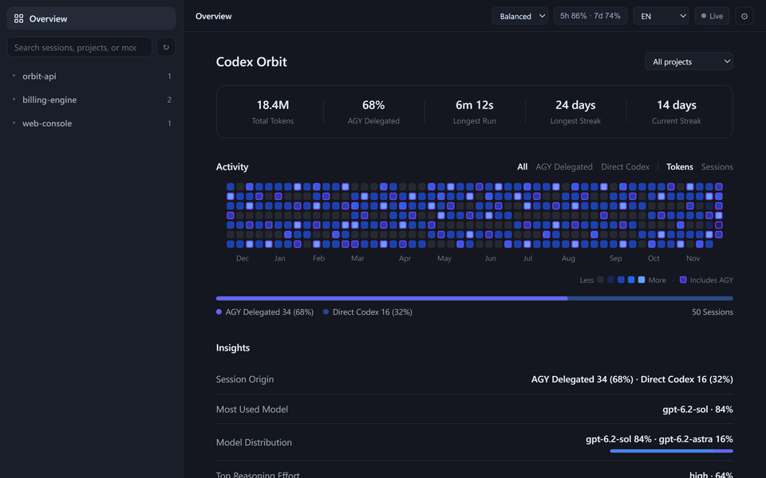
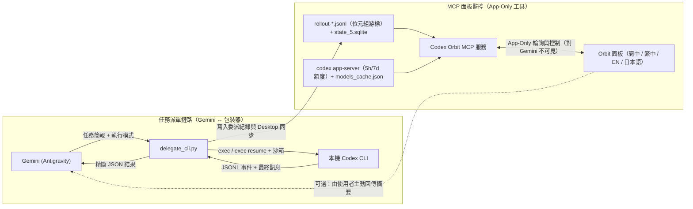
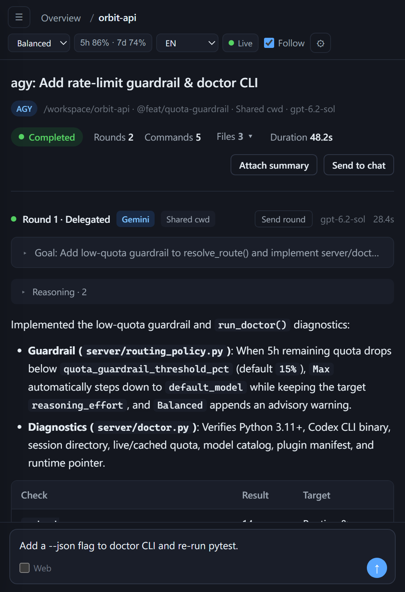

<div align="center">
  
  <h1>Codex Orbit</h1>
  <p>
    <strong>面向 Google Antigravity 2.0 的雙 Agent 委派與零 Token 即時監控駕駛艙</strong>
  </p>
  <p>
    <a href="./README.md">English</a> · <a href="./README.zh-CN.md">简体中文</a> · <strong>繁體中文</strong> · <a href="./README.ja.md">日本語</a>
  </p>
  <p>
    <a href="#為什麼選擇-codex-orbit"></a> <a href="#快速開始"></a> <a href="#核心特色"></a> <a href="./LICENSE"></a> <a href="https://github.com/LIU423/agy-codex-orbit/actions/workflows/ci.yml"></a>
  </p>
</div>

**Codex Orbit** 是專為 Google Antigravity 2.0 打造的 MCP App 外掛，讓 Gemini 將編碼、測試、除錯與審查任務委派給本機 **OpenAI Codex CLI**——內建 Skill 路由、Git worktree 隔離與本機即時監控面板，檢視進度與追問全程不消耗宿主模型 Token。



*52 週 AGY 派單與自行發起熱力圖、模型分佈、5h/7d 額度護欄、7 項環境自檢、即時串流監控與深淺色多語言介面。*

---

## 為什麼選擇 Codex Orbit？

讓一個編碼 Agent 派任務給另一個 Agent，往往要嘛在宿主對話輪詢進度白燒 Token，要嘛子 Agent 執行後變成黑盒。Codex Orbit 將**執行鏈路**與**觀測鏈路**完全分離：Gemini 透過 `delegate_cli.py` 派發具作用域的任務，你在 Orbit 面板即時查看進度並可直接追問（`visibility: ["app"]`），回合結束時 Gemini 只會收到精簡的 JSON 摘要。



### 定位比較

| 比較項目 | 模型 API 閘道<br/>*(OpenRouter / LiteLLM / CCR / CLIProxyAPI)* | Agent 委派工具<br/>*(PAL MCP / `codex-mcp` / `codex-plugin-cc`)* | **Codex Orbit (`agy-codex-orbit`)** |
| :--- | :--- | :--- | :--- |
| **工作單位** | 路由**單次 HTTP 模型請求**（選路、格式轉換、故障回退） | 從宿主調起**另一套 Agent/CLI** | **Antigravity → Codex 駕駛艙**：封裝 `codex exec` / `resume`、沙箱選項與 `--search` |
| **進度觀測與上下文** | 紀錄留在閘道側；上下文佔用取決於用戶端 | 在宿主對話內透過工具回傳值或狀態輪詢取得結果 | **獨立面板外置觀測**：輪詢與追問宣告 `visibility: ["app"]`（0 宿主 Token），主對話只收簡短 JSON |
| **認證與額度** | API Key、Credits 與 OAuth／訂閱上游 | 沿用本機 CLI 登入或設定的 API Key | **沿用本機 Codex 登入**，頂欄即時顯示 5h/7d 額度視窗 |
| **額度感知路由** | 限流重試、憑證輪詢與上游模型回退 | 明確指定模型或靜態角色對應 | **節能 / 均衡 / 極致**：`極致` 在 5h 額度低於門檻時於派單前改用預設模型（保留推理強度）；`均衡` 複雜任務先確認 |
| **歷史與 Desktop 聯動** | 閘道級請求紀錄 | 按各自外掛或橋接工作階段 ID 續接 | **52 週統一 Profile**（合併 AGY 派單與自行發起的本機 JSONL/SQLite）+ Codex Desktop `agy:` 標題與專案綁定 |
| **工作區與控制** | 由呼叫端用戶端管理 | 唯讀審查、背景取消或 worktree 封裝 | **同目錄**、**唯讀**、**Git worktree**，面板一鍵終止程序樹並安全清理閒置 worktree |

---

## 核心特色

### 1. 面板外置即時監控 & 52 週 Profile 總覽
- **雙入口掛載與直接追問**：同時掛載於 Antigravity 左側欄（`global`）與右側輔助欄（`aux_pane`），Gemini 呼叫 `open_codex_orbit(focus_running=True)` 時自動聚焦執行中任務。窄幅右側欄會自動將樹狀清單收合為抽屜，並在底部常駐 **Codex 直接追問輸入框**（`orbit_send_followup`）。面板輪詢與追問皆宣告 `visibility: ["app"]`，不消耗宿主模型 Token。
- **Profile 總覽與熱力圖**：呈現累計 Token、AGY 派單佔比、最長任務耗時、連續活躍天數、**52 週日曆熱力圖**（支援 `全部 / AGY 派單 / 自行發起` 與 `Token / 工作階段數` 切換及日期下鑽）、**模型用量分佈**與高頻變更檔案。
- **清爽閱讀畫布**：可收合的 Prompt 與思考摘要、GFM Markdown 渲染、預設收合為單行灰階的指令列，以及點擊即可在 Antigravity 開啟的變更檔案標籤。
- **多語言介面**：`自動`（跟隨宿主語言）、`EN`、`简体中文`、`繁體中文`、`日本語`。

<p align="center">
  
</p>

### 2. 額度感知三檔排程 & 低額度保護
可隨時從頂欄下拉選單或對話切換策略；**預設主力模型**（`gpt-6.2-sol`）與**複雜升級模型**（`gpt-6.2-astra`）皆可在 **⚙ 設定** 中從 `~/.codex/models_cache.json` 自由選擇。

| 任務難度 | 節能 (`silent_low_cost`) | 均衡 (`ask`，預設) | 極致 (`silent_best`) |
| :--- | :--- | :--- | :--- |
| **輕量 (`light`)** | 預設模型 (`low`/`medium`) | 預設模型 (`medium`) | 預設模型 (`medium`) |
| **一般 (`standard`)** | 預設模型 (`medium`) | 預設模型 (`medium` 審查 / `high` 開發) | 升級模型 (`high`) * |
| **複雜 (`complex`)** | 預設模型 (`high`) | **附即時 5h/7d 額度請使用者確認** | 升級模型 (`xhigh`) * |

*\* **低額度自動保護**（預設於 5h 剩餘 `< 15%` 觸發，門檻可調 `5%–50%`）：`極致` 模式下自動回退預設模型並保留目標推理強度；`均衡` 模式下於升級確認中附帶提醒；頂欄額度徽章轉為琥珀色／紅色。*

### 3. 工作區模式、聯網調研與即時控制
- **同目錄交接 (`workspace-write`，預設)**：依分工約定前後端循序開發時，Codex 直接在目前 Antigravity 工作區寫入程式碼，無需額外合併。
- **唯讀審查 (`read-only`)**：獨立稽核變更或排查問題，不修改工作區檔案。
- **並行隔離 (`worktree`)**：於 `${PLUGIN_DATA}/worktrees` 依工作階段建立獨立 Git worktree，多輪 `resume` 自動沿用，結束後透過 **⚙ 設定 → 清理閒置 Worktree** 或 `--prune-worktrees` 安全清理。
- **聯網調研 (`--web-search`)**：啟用 Codex 原生 `--search` 工具，在 Git 或非 Git 目錄完成即時調查並寫出附引用的 Markdown 報告。
- **程序樹控制與按需回傳**：一鍵終止受管任務程序樹，並支援將精簡回合或工作階段摘要回傳給 Gemini。

### 4. Codex Desktop 銜接
派單任務會透過 `codex app-server`（`thread/name/set`）自動加上 `agy: ` 前綴、綁定對應工作區專案與群組，並在結束後提升閉合 `exec` rollout 的可見性，便於在相容的 Codex Desktop 中繼續檢視或接管*（若 Codex Desktop 已開啟，新建專案可能需要重啟用戶端重新整理）*。

---

## 快速開始

### 前置需求
1. **Google Antigravity 2.0**
2. 已安裝並登入 **OpenAI Codex CLI**（或 Codex Desktop / VS Code Codex 擴充功能）
3. **Python 3.11+** *（一般使用者無需安裝 Node.js 或 `pnpm`，已內建編譯好的單檔前端 `dist/index.html`）*

### 一鍵安裝

**Windows (PowerShell)：**
```powershell
git clone https://github.com/LIU423/agy-codex-orbit.git
cd agy-codex-orbit
.\scripts\install.ps1
```
> 若 `python` 不在 `PATH` 中，傳入 `-PythonBin C:\Path\To\python.exe`。

**macOS / Linux (`sh` / `bash` / `zsh`)：**
```bash
git clone https://github.com/LIU423/agy-codex-orbit.git
cd agy-codex-orbit
./scripts/install.sh
```
> 若需指定 Python 直譯器，執行 `PYTHON_BIN=/path/to/python3 ./scripts/install.sh`。

安裝腳本會將外掛部署至 `~/.gemini/config/plugins/agy-codex-orbit/`，建立獨立 `.venv`、產生 `mcp_config.json` 並自動執行 `--doctor` 自檢。若 **Codex Orbit** 未立即顯示，請在 Antigravity 中重新載入外掛或重啟用戶端。

### 驗證環境 (`--doctor`)
- **介面內檢查**：點擊頂欄 **⚙** → **執行自檢**。
- **命令列檢查**：
  ```powershell
  # Windows
  ~/.gemini/config/plugins/agy-codex-orbit/.venv/Scripts/python.exe -u ~/.gemini/config/plugins/agy-codex-orbit/server/delegate_cli.py --doctor
  ```
  ```bash
  # macOS / Linux
  ~/.gemini/config/plugins/agy-codex-orbit/.venv/bin/python -u ~/.gemini/config/plugins/agy-codex-orbit/server/delegate_cli.py --doctor
  ```

---

## 常見對話用法

在 Antigravity 對話中直接以自然語言指揮即可：

- **開啟監控面板**：*「打開 Codex Orbit，查看最近的 Codex 工作階段與剩餘額度。」*
- **前後端協作**：*「讓 Codex 在目前工作區完成 `/api/webhooks` 驗簽邏輯與 pytest 單元測試，完成後由你接上前端表單。」*
- **唯讀審查**：*「讓 Codex 以唯讀模式審查目前未提交的變更，重點檢查競態與例外處理。」*
- **並行 Worktree**：*「把解析器重構放到隔離 git worktree 讓 Codex 處理，我們這邊繼續調整前端。」*
- **聯網調研**：*「讓 Codex 開啟聯網搜尋研究最新 MCP Apps 規範變更，將附來源引用的報告寫到 `research/mcp-apps.md`。」*
- **切換排程策略**：*「切換到節能模式」* / *「切換到均衡模式」* / *「切換到極致模式」*。

---

## 設定與疑難排解

### 設定項目與 CLI 參數
設定持久化於 `${PLUGIN_DATA}/settings.json`，可在 **⚙ 設定** 或透過 `delegate_cli.py` 修改：

| 設定 / CLI 參數 | 預設值 | 說明 |
| :--- | :--- | :--- |
| `--set-routing-mode` | `ask` | `silent_low_cost`（節能）、`ask`（均衡）、`silent_best`（極致） |
| `--set-default-model` | `gpt-6.2-sol` | 預設主力模型（傳入 `""` 恢復預設） |
| `--set-escalation-model` | `gpt-6.2-astra` | 複雜／極致模式升級模型（傳入 `""` 恢復預設） |
| `--set-quota-guardrail` | `on` | `on` / `off`，開關 5h 低額度保護 |
| `--set-quota-threshold` | `15` | 5h 剩餘額度觸發門檻百分比（`5`–`50`） |
| `--get-settings` / `--doctor` / `--prune-worktrees` | — | 檢視設定、執行 7 項自檢、清理閒置 worktree |

### 環境變數
- `CODEX_ORBIT_CODEX_BIN`：當 `codex` 不在 `PATH` 中時明確指定執行檔路徑。
- `CODEX_HOME`：覆寫 Codex 設定目錄（預設 `~/.codex`）。
- `CODEX_ORBIT_DATA_DIR`：覆寫外掛資料目錄。

### 常見問題
- **`codex_cli` 檢查失敗**：確認已安裝並登入 Codex CLI，或設定 `CODEX_ORBIT_CODEX_BIN`。
- **額度顯示來自 rollout 快取**：即時額度優先透過 `codex app-server` 讀取；離線或未登入時自動回退讀取最新本機 rollout 中的 `rate_limits`。
- **原始碼聯調模式**：開發者請執行 `.\scripts\dev-link.ps1`（Windows）或 `./scripts/dev-link.sh`（macOS/Linux），詳見 [docs/DEVELOPMENT.md](./docs/DEVELOPMENT.md)。

---

## 開發與測試

UI 建置（`ui/`）、開發模式連結（`dev-link.ps1` / `dev-link.sh`）及合成測試（`pytest -v`）說明，請參閱 [docs/DEVELOPMENT.md](./docs/DEVELOPMENT.md)。

在 Antigravity 終端機中熱重新整理 MCP 伺服器：
- **Windows**：`.\scripts\refresh-mcp.ps1`
- **macOS / Linux**：`./scripts/refresh-mcp.sh`

## 開發路線圖

- 發布至 PyPI，支援透過 `uvx` 或 `pipx` 以單一指令安裝。
- 在面板中檢閱 Git worktree 的差異，並一鍵合併、捨棄或清理。
- 為個別委派任務設定逾時、步驟數和預算上限，並支援即時中止或調整方向。
- 加入可插拔的代理程式介接器，支援 Antigravity 與 Codex 之外的工具，例如 Claude Code 和通用 MCP 用戶端。

## 授權條款

採用 [MIT License](./LICENSE) 授權釋出。
